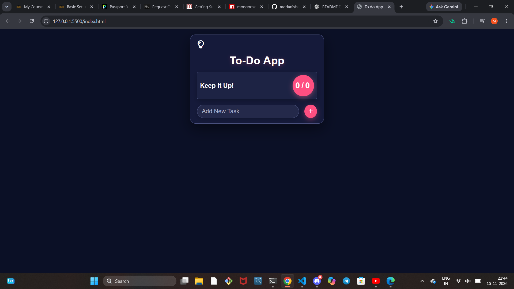

# 📝 To-Do App

A simple and interactive To-Do List Web Application built using HTML, CSS, and JavaScript. It helps users manage their daily tasks by adding, editing, completing, and deleting tasks through a clean and user-friendly interface.

## ✨ Features

• Add new tasks to your to-do list.
• Edit existing tasks.
• Delete tasks when they are no longer needed.
• Mark tasks as completed or pending.
• Display the total number of tasks.
• Track the number of completed tasks.
• Add tasks by pressing the Enter key.
• Interactive buttons with hover effects.
• Clean and user-friendly interface.

## 📸 Project Preview



## 🛠️ Technologies Used

• HTML5 – Used to create the structure of the application.
• CSS3 – Used for styling, layout, colors, and hover effects.
• JavaScript – Used to implement task management functionality and DOM manipulation.
• Font Awesome – Used for icons.

## 🚀 Getting Started

Follow these steps to run the project locally.

### 1. Clone the Repository

```bash
git clone https://github.com/mddanishahmad010-max/To-do-App.git
```

### 2. Open the Project Folder

```bash
cd To-do-App
```

### 3. Run the Application

Open the `index.html` file in your web browser.

That's it! Your To-Do App is ready to use.

## 🔮 Future Improvements

• Implement a proper Dark and Light Theme.
• Save tasks using Local Storage.
• Add task filtering (All, Completed, Pending).
• Improve the user interface and animations.
• Add task deadlines and priorities.

## 👨‍💻 Author

Md Danish Ahmad

